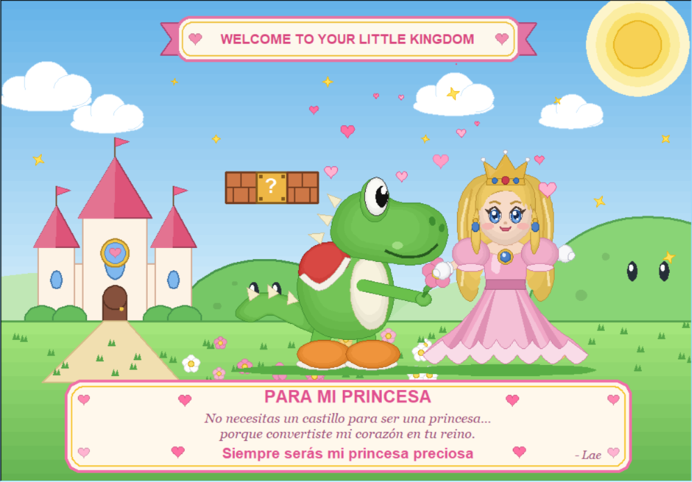

# A Little Kingdom for My Princess ♡

A little animated kingdom, inspired by the magical world of Princess Peach and Yoshi, created with Python Turtle.

This project is a small digital gift dedicated to **Valbb**, my princess. It brings together a colorful fairytale kingdom, a castle, cheerful characters, floating hearts, and a little message to remind her how special she is to me.

Because sometimes, a princess doesn't need a castle to be a princess. Sometimes, she simply needs someone who reminds her that she has a kingdom in their heart.

## ✨ Features

- **A Fairytale Kingdom:** A colorful landscape featuring a beautiful castle, rolling green hills, a sunny sky, flowers, and a winding path.
- **Princess Peach:** A custom-drawn character inspired by Princess Peach, complete with her iconic pink dress, golden crown, blue earrings, and a welcoming wave.
- **Yoshi's Arrival:** Yoshi walks across the kingdom to meet the princess, with animated walking and idle poses.
- **A Sweet Welcome:** Peach waves and reaches out her hand as Yoshi approaches.
- **Floating Hearts:** Pink hearts gradually appear and float upward when the characters get close.
- **Magical Sparkles:** Golden sparkles illuminate the kingdom, adding a little extra magic to the scene.
- **Moving Clouds:** Soft clouds drift across the sky throughout the animation.
- **A Personal Dedication:** A romantic message appears line by line at the bottom of the screen.

## 💗 The Message

As the animation unfolds, a little dedication appears:

> PARA MI PRINCESA
>
> No necesitas un castillo para ser una princesa...
>
> porque convertiste mi corazón en tu reino.
>
> Siempre serás mi princesa preciosa.
>
> — Lae

A simple message with a very special meaning: she doesn't need a fairytale kingdom to be my princess, because she has already made my heart her home.

## 🎨 Graphical Representation

The following folder contains visual references and recordings of the animation.

**Project Preview:**
<div align="center">
  
</div>


**Animation:**

[Watch the animation](graphical-representation/princess.mp4)

## 🛠️ Technologies Used

- **Python 3** — Main programming language.
- **Turtle** — Character illustrations, shapes, and animation.
- **Tkinter** — Window management through Turtle's graphical interface.
- **Math** — Geometric calculations, movement, and animation curves.
- **Random** — Decorative elements and floating hearts.

The project uses Python's standard library, so no additional package installation is required.

## 🚀 How to Run

1. Make sure Python 3 is installed on your computer.
2. Clone this repository:

   ```bash
   git clone https://github.com/laetg404/a-little-kingdom-for-my-princess.git
   ```

3. Navigate to the project directory:

   ```bash
   cd a-little-kingdom-for-my-princess
   ```

4. Run the script:

   ```bash
   python main.py
   ```

The animation will start automatically in a new window.

## 📁 Project Structure

```text
a-little-kingdom-for-my-princess/
│
├── graphical-representation/
│   ├── kingdom.png
│   └── kingdom.mp4
│
├── main.py
└── README.md
```

## 👑 A Little Dedication

**To Valbb, my beautiful princess.**

You don't need a castle, a crown, or an entire kingdom to be someone extraordinary.

You already have something much more special: a place in my heart that belongs only to you.

I made this little world with a princess, a little dinosaur, flowers, sunshine, and lots of hearts. And even though it's just a small animation, every detail carries a little bit of the affection I have for you.

If I could build you a kingdom, I would make it a place where you could always feel loved, safe, and happy.

Until then, I'll keep building little worlds with code, just to make you smile.

**You will always be my princess. ♡**

---

<sub>Part of a collection of little projects created with love.</sub>

👑🦖
